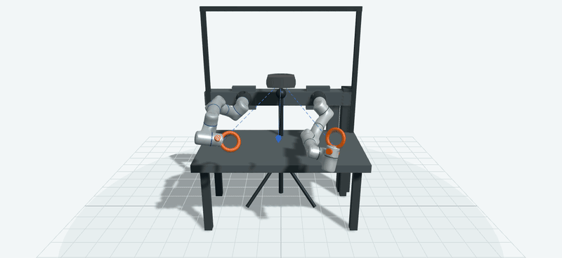

# ego-robot-calibration / public test walkthrough

This is the compact public homepage for the ego-robot calibration test protocol. It reuses the existing modeling and trajectory scenes from the [report repository](https://github.com/yj244-jyt/ego-robot-calibration-reports) and exposes a small, device-independent math reference from the latest private source repository.

## Test flow

`setup → static calibration → time alignment → trajectory replay → report / qualification`

The public report currently describes a Flexiv Rizon dual arm paired with a Meta Quest 3 right controller. The formal protocol is organized around 16 static poses and 8 independent replay paths at each target speed (`0.5 / 1.0 / 1.5 m/s`). Static, continuous-trajectory, and speed evidence remain separate in the final report.

### Test logic

1. **Setup:** freeze the robot/tool fixture, headset world frame, device identities, and coordinate epoch.
2. **Static calibration:** collect stable pose windows across the workspace, reject motion-in-dwell windows, and solve the hand-eye relation from paired robot/observer motions.
3. **Time alignment:** resample both streams on one integer-nanosecond axis. Interpolation never extrapolates and rejects gaps over the configured limit.
4. **Replay:** evaluate the frozen calibration on held-out trajectories. The same public time axis is used for Robot and Quest position, orientation, velocity, and validity.
5. **Qualification:** report translation and rotation separately, preserve invalid-sample reasons, and keep pending/fail states visible instead of turning missing evidence into a pass.

## Existing report scenes

The images below are rendered directly from the current public Quest3 report page. They are explanatory snapshots, not new model drawings.

### Experiment setup



The 360-degree GIF is the first-stage setup scene from the existing report: dual-arm fixture, headset observation rays, controller/tool relationship, and workspace frame. The public capture removes the report overlay only; the 3D model is unchanged.

### Static calibration


This is the report's second-stage view: 16 static calibration points are sampled around the shared workspace before the replay windows are evaluated.

### Trajectory playback


The player keeps Robot and Quest trajectories in the same coordinate frame and exposes the instantaneous error between them.

### Short replay animation


This GIF is a frame-by-frame capture of the existing report player's trajectory replay. It contains derived display geometry only; no raw Robot or Quest stream is published here.

## Mathematical reference

The public code in [`public_math/`](public_math/) mirrors the report-facing equations without publishing device adapters, acquisition orchestration, or run data.

### Coordinate and hand-eye model

`T_AB` maps a point expressed in frame `B` into frame `A`. The shared tool frame is aligned by:

$$
T_{BE}T_{EC}=T_{BW}T_{WC}, \qquad
\widehat{T}_{BE}=T_{BW}T_{WC}T_{EC}^{-1}
$$

For paired robot and observer motions:

$$
\begin{aligned}
A_{ij} &= T_{BE,i}^{-1}T_{BE,j},\\
B_{ij} &= T_{WC,i}^{-1}T_{WC,j},\\
A_{ij}X &= XB_{ij}.
\end{aligned}
$$

`public_math/hand_eye.py` selects rotationally exciting motion pairs, solves the Park-Martin rotation, and then solves the translation by least squares. `public_math/robust_fit.py` optionally refines both transforms with a soft-L1 loss. `public_math/se3.py` keeps all residuals on `SE(3)` rather than subtracting Euler angles.

### Error, velocity, and coverage

For a synchronized sample `k`:

$$
\begin{aligned}
e_p(k) &= \left\|p_{\mathrm{Quest}}(k)-p_{\mathrm{Robot}}(k)\right\|_2,\\
e_R(k) &= \operatorname{angle}\!\left(T_{\mathrm{Robot}}(k)^{-1}T_{\mathrm{Quest}}(k)\right),\\
v(k) &= \frac{\left\|p(k+1)-p(k-1)\right\|_2}{t(k+1)-t(k-1)},\\
C(t) &= \frac{N_{\mathrm{valid}}(t)}{N_{\mathrm{candidate}}(t)}.
\end{aligned}
$$

`public_math/metrics.py` contains the report statistics (mean, MAE, RMSE, median, P95, maximum), effective coverage, and a Wilson interval for a valid/candidate fraction. Confidence intervals use group bootstrap: whole independent poses or trajectories are resampled, never individual frames from one dwell window.

The uncertainty budget is first-order and explicit:

$$
\sigma_{\mathrm{total}}=\sqrt{\sigma_{\mathrm{ego}}^2+\sigma_{\mathrm{robot}}^2+(v\,\sigma_t)^2+(\ell\,\sigma_{\theta})^2+\sigma_{\mathrm{fixture}}^2+\sigma_{\mathrm{calibration}}^2}
$$

The code labels these as sigma-like terms and never mixes them with empirical P95 errors.

Run the reference tests after installing `requirements.txt`:

```bash
python -m pytest -q tests/test_public_math.py
```

## Public boundary

Included: the protocol phases, report-facing terminology, setup model, static/trajectory explanation, public mathematical formulas, device-independent math code, and current report links.

Excluded: raw Robot and Quest streams, calibration archives, device-specific geometry files, serial captures, acquisition/device adapters, credentials, and private workspace measurements.

The current public snapshot follows report-site commit `b96f8ec` (`Simplify Quest3 report layout`). The public math reference was extracted and simplified from source commit `04a2622` (`Add Quest3 calibration and velocity replay workflow`). The Quest3 static-stage values are diagnostic and marked pending qualification in the source report.

## Source

- [ego-robot-calibration](https://github.com/yj244-jyt/ego-robot-calibration)
- [ego-robot-calibration-reports](https://github.com/yj244-jyt/ego-robot-calibration-reports)
- [Open the full Quest3 report](https://yj244-jyt.github.io/ego-robot-calibration-reports/reports/QUEST3/run-155f73eef95144baa85bc13a947eb501-static-stage/)
