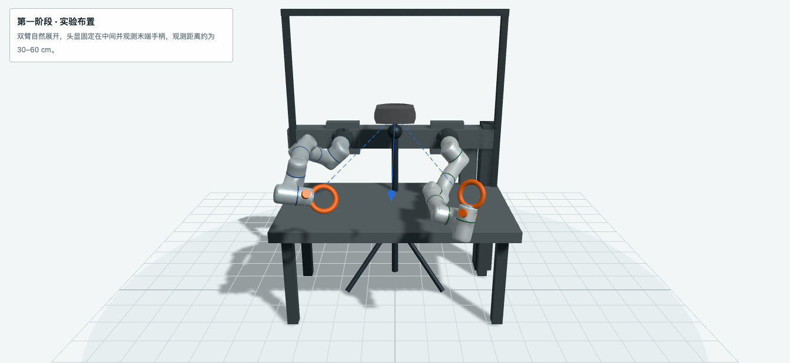
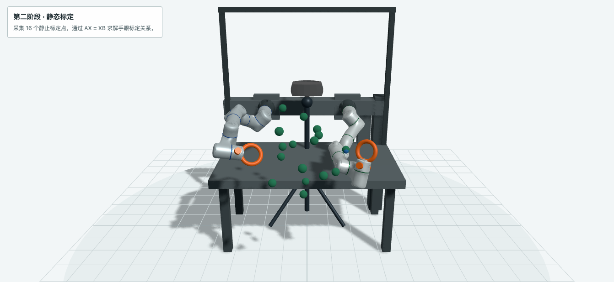
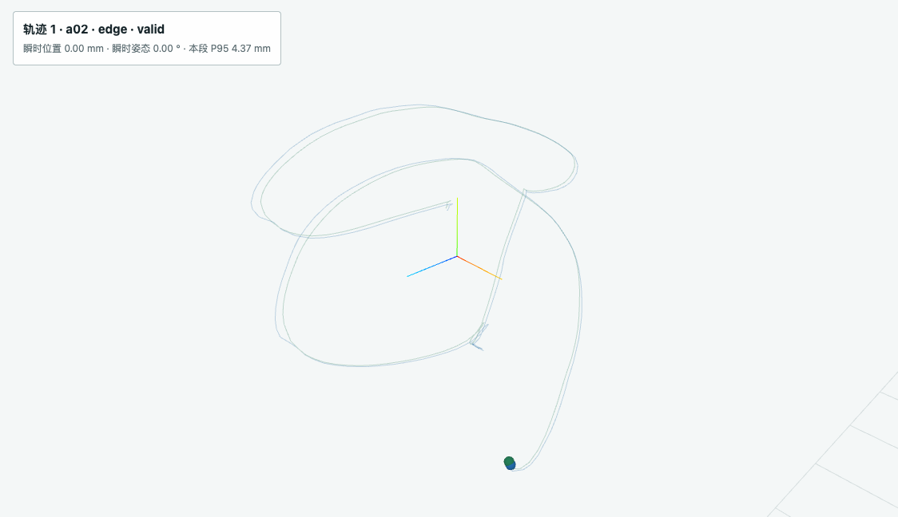
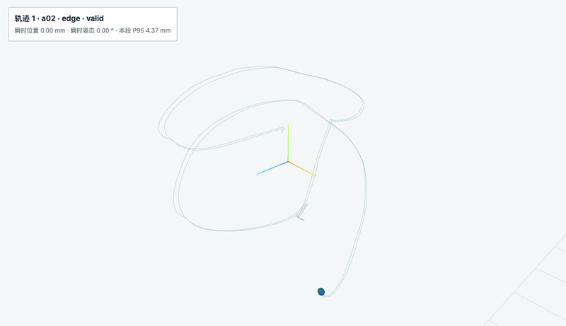

# ego-robot-calibration / public test walkthrough

This is the compact public homepage for the ego-robot calibration test protocol. It reuses the existing modeling and trajectory scenes from the [report repository](https://github.com/yj244-jyt/ego-robot-calibration-reports) instead of recreating the private implementation.

## Test flow

`setup → static calibration → time alignment → trajectory replay → report / qualification`

The public report currently describes a Flexiv Rizon dual arm paired with a Meta Quest 3 right controller. The formal protocol is organized around 16 static poses and 8 independent replay paths at each target speed (`0.5 / 1.0 / 1.5 m/s`). Static, continuous-trajectory, and speed evidence remain separate in the final report.

## Existing report scenes

The images below are rendered directly from the current public Quest3 report page. They are explanatory snapshots, not new model drawings.

### Experiment setup

The model shows the dual-arm fixture, headset observation rays, controller/tool relationship, and the workspace frame used by the report.

### Static calibration

This is the report's second-stage view: 16 static calibration points are sampled around the shared workspace before the replay windows are evaluated.

### Trajectory playback

The player keeps Robot and Quest trajectories in the same coordinate frame and exposes the instantaneous error between them.

### Short replay animation

This GIF is a short capture of the existing report player's trajectory replay. It contains derived display geometry only; no raw Robot or Quest stream is published here.

## Public boundary

Included: the protocol phases, report-facing terminology, setup model, static/trajectory explanation, and current report links.

Excluded: raw Robot and Quest streams, calibration archives, device-specific geometry files, serial captures, internal collection code, credentials, and private workspace measurements.

The current public snapshot follows report-site commit `b96f8ec` (`Simplify Quest3 report layout`). The Quest3 static-stage values are diagnostic and marked pending qualification in the source report.

## Source

- [ego-robot-calibration](https://github.com/yj244-jyt/ego-robot-calibration)
- [ego-robot-calibration-reports](https://github.com/yj244-jyt/ego-robot-calibration-reports)
- [Open the full Quest3 report](https://yj244-jyt.github.io/ego-robot-calibration-reports/reports/QUEST3/run-155f73eef95144baa85bc13a947eb501-static-stage/)
